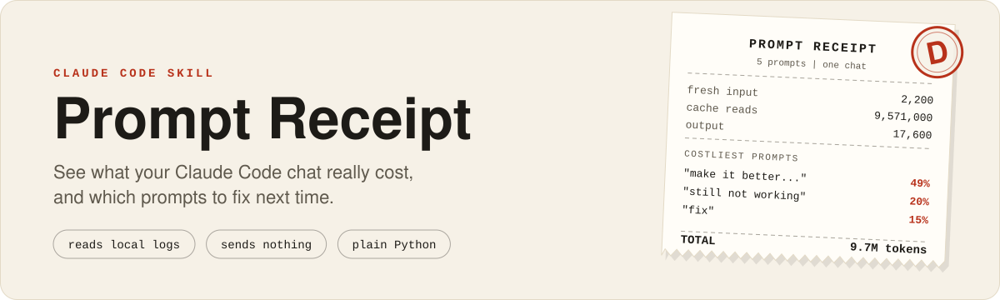
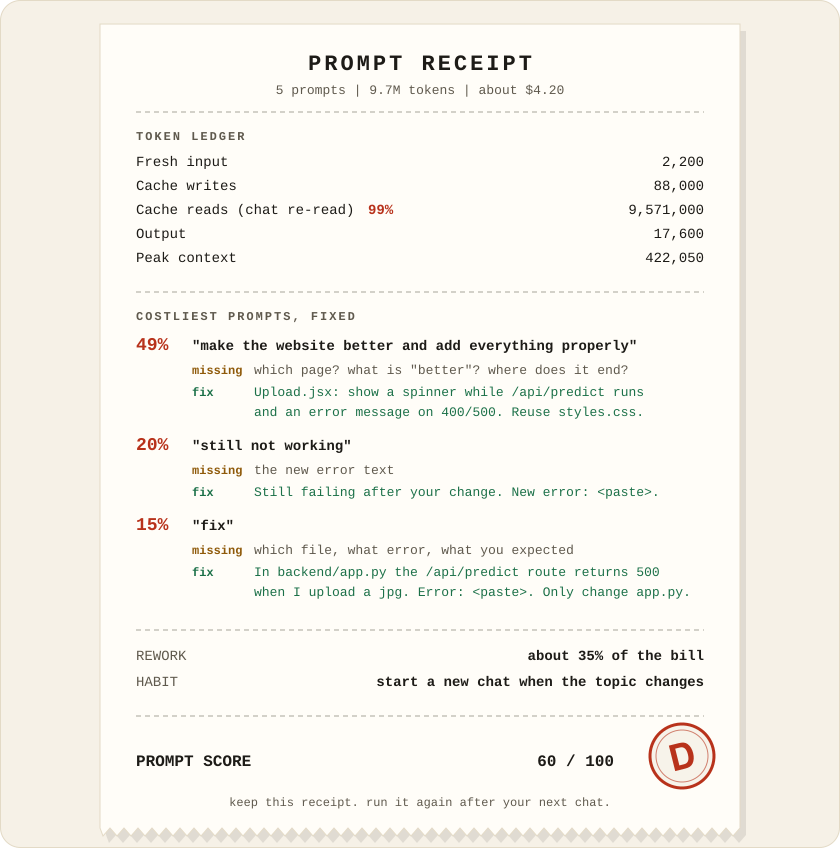
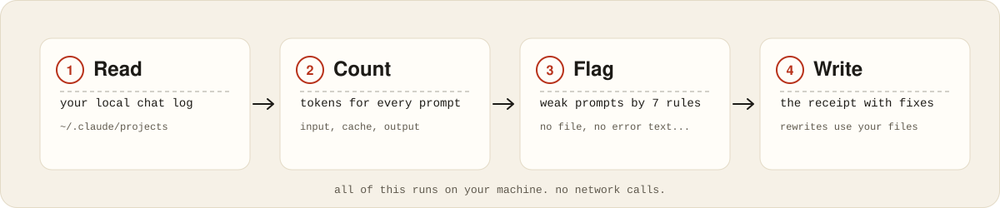
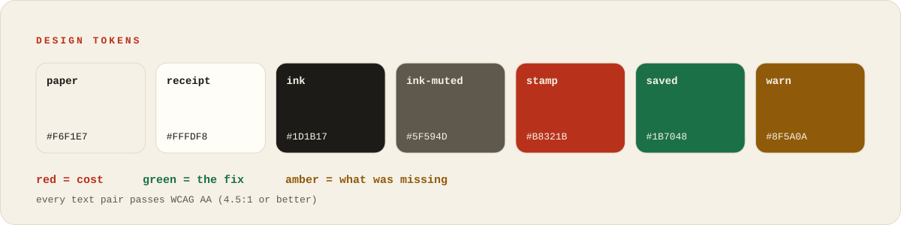

<div align="center">



<br>


**Run it when a chat ends. Get an itemized bill, the prompts that cost the most, and what to type instead.**

</div>

<br>

## Why this exists

Most of the tokens in a long Claude Code chat are not spent on your prompts. They are spent on Claude **re-reading the whole earlier chat on every message**. A one-word `fix` makes Claude search the project to guess what you meant. An error you *describe* instead of *paste* gets a guess, not a diagnosis.

Prompt Receipt reads the chat that just finished, finds those moments, and shows you the exact words to use next time. It never shames you: every criticism comes with the fix, and the review opens with what you did well.

## What you get

| | |
|---|---|
| **Headline** | total tokens, cost (if the log has it), a prompt score with a letter grade |
| **Token ledger** | fresh input, cache writes, cache reads, output, peak context size |
| **Costliest prompts, fixed** | each one with what it was missing and a rewrite that uses *your* file names |
| **Habits that save the most** | when to start a new chat, when to use `/compact`, what belongs in `CLAUDE.md` |
| **Next-chat starter** | a paste-ready summary so a half-finished project moves on without a huge context |

## An example receipt

This is real output for the bundled `vague-fix-chat` test chat (5 prompts, 9.7M tokens).

<div align="center">

</div>

## Install

Prompt Receipt is a Claude Code skill: a folder with a `SKILL.md`. Copy it into your skills directory.

```bash
git clone https://github.com/buildwithabhinav-ai/prompt-receipt.git
cp -R prompt-receipt/prompt-receipt ~/.claude/skills/
```

Start a new Claude Code session so the skill is picked up. Requires Python 3. No packages to install.

## Use it

At the end of a chat, say any of these:

> `review this chat` · `prompt receipt` · `where did my tokens go` · `how could I have prompted better`

Or run the analyzer yourself:

```bash
python3 -I ~/.claude/skills/prompt-receipt/scripts/analyze_chat.py --format table
```

| Flag | What it does |
|---|---|
| *(none)* | analyzes the newest chat of the current folder |
| `--list` | lists recent chats so you can pick one |
| `--session <id>` | a specific chat (an id, a prefix, or a `.jsonl` path) |
| `--project-dir <dir>` | a project folder under `~/.claude/projects` |
| `--format table` | readable table instead of JSON |
| `--top N` | how many costliest prompts to name |

No logs (claude.ai, Cowork)? The skill still works from the conversation itself and says clearly that every number is an estimate.

## How it works

<div align="center">

</div>

The analyzer uses plain rules, not a model, so every number can be explained. Claude then does the judging: a flag is a reason to look, not a verdict (a short `fix` right after Claude asked "should I fix it?" is fine, and the skill says so).

<details>
<summary><b>What the analyzer flags</b></summary>

<br>

| Flag | Points | Fires when | Usual fix |
|---|---:|---|---|
| `no_target` | -25 | action prompt names no file, path, function or route | name the file, page or endpoint |
| `problem_without_evidence` | -25 | says "error" or "not working" but pastes no error, status code or screenshot | paste the exact error |
| `vague_words` | -10 | "properly", "everything", "better", "etc" | say what "properly" looks like |
| `too_short` | -15 | action prompt under 8 words | add target and expected result |
| `multi_task` | -15 | five or more verbs or list items | one goal per message |
| `no_expected_outcome` | -10 | build prompt with no "should / expected / returns" | say what done looks like |
| `huge_paste` | -5 | over 4000 characters | paste only the relevant part |

Approvals like "Yes, push it", and prompts interrupted before Claude answered, are not scored. The overall grade is weighted by each prompt's share of cost, so a vague prompt that cost 49% matters more than a vague one that cost 1%. Full detail, including known blind spots, is in [`rubric.md`](prompt-receipt/references/rubric.md).

</details>

## Honest by design

- **Estimates are labelled.** The log holds one cost total per chat; per-prompt dollars are that total split by token weight. Good for ranking prompts, not for billing.
- **No invented savings.** The skill says what a better prompt would likely have *avoided*, never "you would have saved 40%".
- **Short when it should be.** If the chat was already efficient, the review says so and stops.
- **Nothing leaves your machine.** The script only reads local files. Anything shaped like a key, token or password is masked before it can appear in a review.

## Tested on

Three bundled test chats in [`prompt-receipt/evals`](prompt-receipt/evals), each with graders:

| Case | Checks |
|---|---|
| `vague-fix-chat` | names the vague prompts, rewrites them with real file names, flags the correction as rework, credits the one good prompt |
| `already-efficient-chat` | says the chat was efficient and invents no problems |
| `no-logs-fallback` | no log available: numbers are marked as estimates, none fabricated |

It has also been run against real chats, including a 63-prompt, 325M-token session, which is how the approval-reply and idle-time bugs were found and fixed.

## Project layout

```text
.
├── README.md
├── LICENSE                    MIT
├── DESIGN.md                  design tokens and rules for this repo
├── assets/                    banner, example receipt, flow, palette (SVG)
└── prompt-receipt/            <- the skill. copy this folder
    ├── SKILL.md               instructions Claude follows
    ├── scripts/analyze_chat.py
    ├── references/            rubric, prompt-fix templates, example review
    └── evals/                 three test chats with graders
```

## Design language

The skill itemizes a bill, so the whole look is a **thermal receipt**: warm paper, mono type, dashed rules, and one red stamp for the grade. The tokens live in [`DESIGN.md`](DESIGN.md).

<div align="center">

</div>

Red always means **cost**, green the **fix**, amber **what was missing**. Every text pair passes WCAG AA.

## License

[MIT](LICENSE)
